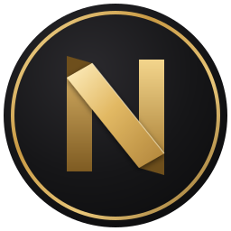
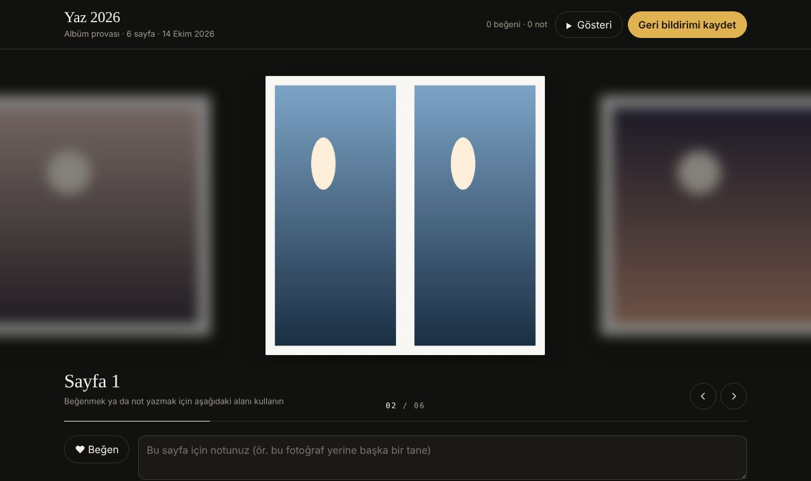
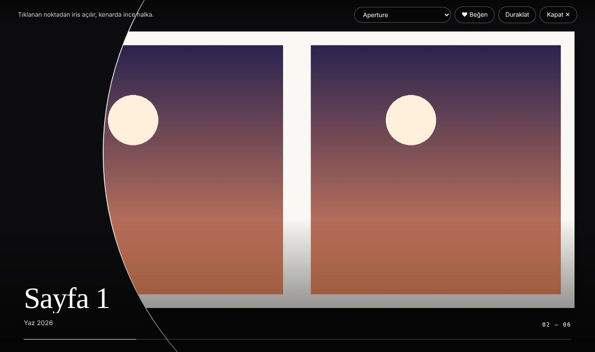

<div align="center">



# NexAlbum

**Fotoğraflarınızı hikâyeye dönüştürün.**

Ücretsiz ve açık kaynak albüm tasarım stüdyosu: otomatik yerleşim, baskıya hazır PDF, kapak ve sırt,
pro geçiş efektli hikâye filmi, müşteriye çevrimdışı HTML prova. Hesap yok, bulut yok, abonelik yok.

[](https://github.com/Eirahoutmoss/NexAlbum/actions/workflows/test.yml)
[](https://github.com/Eirahoutmoss/NexAlbum/actions/workflows/build.yml)
[](https://github.com/Eirahoutmoss/NexAlbum/tree/ekran/main)
[](LICENSE)
[](https://dotnet.microsoft.com/download/dotnet/10.0)
[](#kurulum)

[Özellikler](#neler-yapabilir) · [Ekran görüntüleri](#ekran-görüntüleri) · [Kurulum](#kurulum) · [Mimari](#mimari) · [Katkı](CONTRIBUTING.md) · [Kararlar](docs/kararlar/INDEKS.md)


</div>

---

## Neden NexAlbum?

Albüm tasarımı çoğu zaman pahalı lisanslara, buluta yüklenen fotoğraflara ve baskı evinin kapalı araçlarına bağlıdır.
NexAlbum bunun tersini hedefler:

- **Yerel ve özel** — fotoğraflarınız bilgisayarınızdan çıkmaz; internet gerekmez, telemetri yok.
- **Açık dosya biçimi** — `.albumproj` sıradan bir ZIP + JSON; yıllar sonra da açılır, başka araçlarla okunur.
- **Değer uydurmaz** — taşma payı, güvenli alan, DPI, sırt genişliği baskı evinizden gelir; eksikse uygulama söyler.
- **Her etkinliğe uyar** — gezi, doğum günü, mezuniyet, aile günü, düğün… Bölüm adları zamandan gelir (Sabah, Öğle, «Cumartesi · Akşam»).
- **Türkçe öncelikli** — arayüz, belgeler ve karar kayıtları Türkçe; ı/İ tuzaklarına karşı derleme düzeyinde korumalı.

## Neler yapabilir?

| | |
|---|---|
| 🧭 **Otomatik albüm** | Hızlı / Dengeli / Kontrollü yerleşim; 200+ şablon (1–12 fotoğraf), 28 geometrik şablon (üçgen, altıgen, elmas, kemer…). Tohumlu ve deterministik: aynı girdi → aynı albüm. Fotoğraf asla esnetilmez, kilitli sayfalara dokunulmaz. |
| 📖 **Hikâye akışı** | Çekim saatinden bölümler, zaman çizelgesi, bölüm açılış sayfaları. İki makine/iki fotoğrafçı varsa **makine saat farkı** otomatik eşitlenir. |
| ✍️ **Elle düzenleme** | Galeriden sürükle-bırak, yuvalar arası taşıma, imlecin olduğu noktaya yakınlaşma, konumlandırma kipi, **çerçeve kipi** (taşı, boyutlandır, geometrik köşeleri sürükle), akıllı hizalama çizgileri. |
| 🎨 **Fotoğraf ayarları** | Pozlama, parlaklık, kontrast, sıcaklık, doygunluk, siyah-beyaz, ±15° düzeltme — tahribatsız; ekranda ne görüyorsanız PDF'te o. |
| 🔤 **Albüm yazıları** | 8 gömülü yazı tipi (el yazısı, serif, sans), gölge / hale / kontur / bant / kabartma etkileri, «Okunur yap». |
| 📕 **Kapak ve sırt** | Arka + sırt + ön tek yaprak, katlama çizgileri; ayrı kapak PDF'i (katlama işaretli). |
| 🖨️ **Baskı PDF'i** | Taşma payı, kesim işaretleri, TrimBox/BleedBox; JPEG'ler yeniden sıkıştırılmadan gömülür. Ön kontrol: DPI, güvenli alan, eksik dosya, yazı tipi. |
| 🎬 **Hikâye filmi** | 9:16 / 1:1 / 4:5 sosyal medya ya da Full HD / 2K / 4K film; yerel müzik kütüphanesi, vuruşa oturan kesmeler; FFmpeg yoksa izin isteyip kurar. |
| ✨ **33 pro efekt** | Aperture (tıklanan noktadan iris), diyafram kanatları, petek, mürekkep lekesi, ışık sızıntısı, film yanığı, Polaroid banyosu, sayfa çevirme… Filmde, sunumda ve HTML provada **aynı hesapla** çalışır. |
| 🖥️ **Sunum (F5)** | Tam ekran; tıklanan noktadan açılan geçişler, «Sonraki/Önceki» merceği, otomatik oynatma, «Göz at» odak şeridi. |
| 💌 **HTML prova** | Müşteriye tek dosya: sayfalar odak şeridinde gezilir, ♥ ve not bırakılır, tam ekran gösteri; dönen geri bildirim sayfalara not olarak işlenir. Çevrimdışı. |
| 🧩 **Eklenti paketleri** | `.nexpaket` — yalnızca veri taşıyan stil paketleri (kod çalıştırmaz); [biçim belgesi](docs/eklentiler.md), [örnek paket](samples/eklentiler/ornek-sinema). |

## Ekran görüntüleri

Görüntüler her değişiklikte CI tarafından gerçek uygulamadan üretilir ([`ekran/main`](https://github.com/Eirahoutmoss/NexAlbum/tree/ekran/main)).

<table>
  <tr>
    <td><br><sub><b>Şablonlar</b> — geometrik yuvalar, sayfanın kendi fotoğraflarıyla önizleme</sub></td>
    <td><br><sub><b>Hikâye</b> — zamansal bölümler, zaman çizelgesi, makine saatleri</sub></td>
  </tr>
  <tr>
    <td><br><sub><b>Sunum</b> — Aperture: tıklanan noktadan açılan iris ve halka</sub></td>
    <td><br><sub><b>Hikâye filmi</b> — stil, biçim, müzik ve canlı önizleme</sub></td>
  </tr>
  <tr>
    <td><br><sub><b>Kapak</b> — arka + sırt + ön, katlama çizgileri</sub></td>
    <td><br><sub><b>Çerçeve kipi</b> — tutamaçlar, köşe düzenleme, hizalama</sub></td>
  </tr>
  <tr>
    <td><br><sub><b>HTML prova</b> — odak şeridi, beğeni ve not</sub></td>
    <td><br><sub><b>HTML prova</b> — tam ekran gösteri, 33 efekt</sub></td>
  </tr>
</table>

<details>
<summary>Fildişi (açık) tema</summary>


</details>

## Kurulum

Henüz hazır kurulum paketi yok; kaynaktan birkaç dakikada çalışır.

**Gereksinim:** Windows 10/11 ve [.NET 10 SDK](https://dotnet.microsoft.com/download/dotnet/10.0) (`dotnet --list-sdks` ile 10.0.1xx görünmeli).

```powershell
git clone https://github.com/Eirahoutmoss/NexAlbum.git
cd NexAlbum
dotnet run --project src/NexAlbum.UI
```

Güncellemek için: `git pull` ve aynı komut. Hikâye filmi için FFmpeg gerekir; yoksa uygulama ilk kullanımda izin isteyip indirir.

### İlk albüm, beş adımda

1. **Yeni** → baskı profilini seçin (ölçüleri baskı evinizden alın; bilinmeyen alanı boş bırakın).
2. **Fotoğraf** ya da **Klasör** ile fotoğrafları ekleyin.
3. **Oto Oluştur** — beğenmezseniz **Farklı**.
4. Sürükleyin, yakınlaştırın, yazı ekleyin; **Hikâye** sekmesinden bölümleri bulun.
5. **Ön kontrol** → **PDF Çıktı**. Müşteriye göstermek için başlıktaki **Paylaş** menüsünden **HTML prova**.

<details>
<summary>Kısayollar</summary>

| Kısayol | İş |
|---|---|
| Ctrl+K | Komut paleti (her şey burada aranabilir) |
| Ctrl+Z / Ctrl+Y | Geri al / yinele |
| Ctrl+B | Kitap görünümü (karşılıklı sayfalar) |
| F5 | Sunum · E efekt · P otomatik · G göz at · Esc çık |
| Ctrl+T | Metin ekle |
| F | Favori |
| Çift tık (yuva) | Konumlandırma kipi · yön tuşları, +/−, Home |
| Ctrl+tekerlek, Ctrl+0 | Tuval yakınlaştırma, %100 = gerçek baskı boyutu |

</details>

## Mimari

```
NexAlbum.Core          saf domain: albüm, şablon, yerleşim, hikâye, efekt hesabı, ön kontrol  (hiçbir şeye bağımlı değil)
├─ NexAlbum.Rendering  SkiaSharp: film kareleri, efekt çizici
├─ NexAlbum.Export     PDF (PDFsharp), HTML prova + efekt betiği
├─ NexAlbum.Assets     içe aktarma, EXIF
├─ NexAlbum.Persistence .albumproj (ZIP + JSON), şema göçleri, eklenti paketleri
├─ NexAlbum.Video      FFmpeg bulma/kurma, kodlama, müzik
├─ NexAlbum.Integrations Photoshop / harici düzenleyiciler
└─ NexAlbum.UI         WPF + MVVM (CommunityToolkit.Mvvm)
```

- **Katman kuralı** otomatik denetlenir (`tests/NexAlbum.Architecture.Tests`); Core'a WPF, Skia ya da IO giremez.
- **Tek hesap, üç çizici:** efektler Core'da saf işlevdir; film (Skia), sunum (WPF) ve HTML prova (tarayıcı) aynı kareyi çizer.
  Tarayıcı betiğinin C# ile birebir aynı sonucu verdiği her derlemede test edilir.
- **Kararlar yazılıdır:** her önemli tercih [`docs/kararlar/`](docs/kararlar/INDEKS.md) altında gerekçesiyle; değişiklik "revizyon" olarak eklenir.
- **Dosya biçimi sürümlüdür:** şema v8; her sürüm artışı bir göç adımı ve testi ister.

## Kalite

- **~880 test** (Windows) / **~770 test** (Ubuntu) her itmede çalışır; başarısız ya da hiç çalışmayan test derlemeyi kırar.
- Kapsam (satır): Core %94, Persistence %98, Export %97, Assets %96, Rendering %83.
- Uyarılar hata sayılır; Türkçe kültür tuzakları (CA1304/1305/1309/1310/1311) derlemeyi kırar.
- Arayüz ekran görüntüleri her dalda iki temada otomatik üretilir.

## Yol haritası

Güncel durum ve sıradaki işler: [`docs/DEVAM.md`](docs/DEVAM.md). Öne çıkanlar: efekt seçiminde canlı önizleme ızgarası,
eklenti paketlerinin 2. aşaması (yazı/çerçeve stilleri, LUT görünümleri, şablon paketleri), sırt yazısı, kurulum paketi.

## Katkı

Hata bildirimi, öneri, şablon, baskı profili, çeviri ve kod katkıları memnuniyetle karşılanır — önce
[katkı rehberini](CONTRIBUTING.md) ve [davranış kurallarını](CODE_OF_CONDUCT.md) okuyun. Güvenlik açıkları için [SECURITY.md](SECURITY.md).

## Lisans

[GPL-3.0-or-later](LICENSE) © Hasan Güler. Gömülü yazı tipleri (SIL OFL) ve ikonlar (ISC/MIT): [THIRD-PARTY-NOTICES.md](THIRD-PARTY-NOTICES.md).

---

<details>
<summary><b>English summary</b></summary>

**NexAlbum** is a free, open-source (GPL-3.0-or-later), offline photo-album design studio for Windows, built with .NET 10 / WPF.
It lays out albums automatically (deterministic, seeded; 200+ templates including geometric slots), produces print-ready PDFs
(bleed, crop marks, TrimBox/BleedBox, no JPEG recompression), designs covers with spines, turns story chapters into films with
33 pro transitions (Aperture iris, diaphragm, honeycomb, ink blot, light leak, page turn…) and music, presents albums full screen,
and exports a single-file offline HTML proof where clients like pages and leave notes that flow back into the project.
The UI and documentation are Turkish-first. Build: `dotnet run --project src/NexAlbum.UI` (requires the .NET 10 SDK).

</details>
